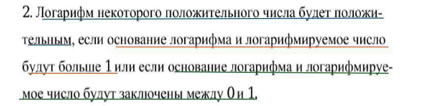
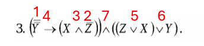
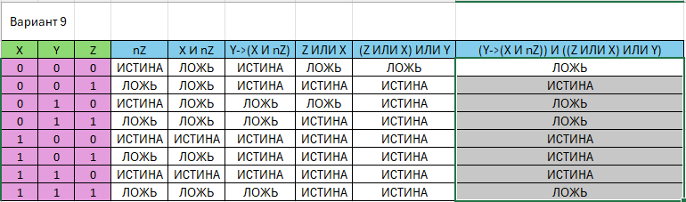
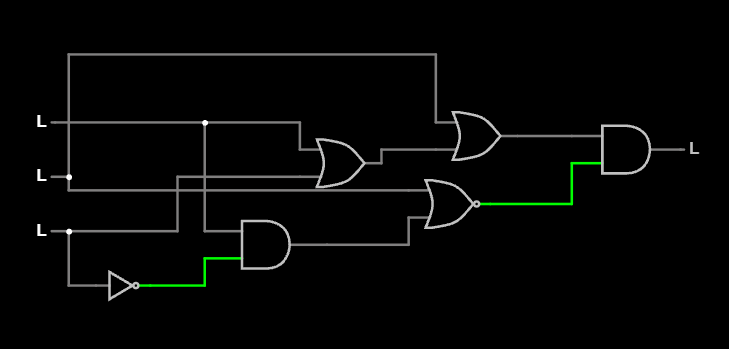

# Вариант 9: решения задач
## №1

<b>Ответ:</b> 1

## №2

A = логарифм некоторого положительного числа будет положительным

B = основание логарифма и логарифмируемое число будут больше 1

C = основание логарифма и логарифмируемое число будут заключены между 0 и 1

## №3

<a href="https://falstad.com/circuit/">сайт</a>

## №4

(¬A ∧ B) ∨ (B ∨ A)

<pre>
|  A  |  B  | ¬A  |¬A ∧ B | B ∨ A |
|  0  |  0  |  1  |   0   |   0   |
|  0  |  1  |  1  |   0   |   1   |
|  1  |  0  |  0  |   0   |   1   |
|  1  |  1  |  0  |   1   |   1   |
</pre>

## №5

((¬x ∧ ¬y) → (y ∧ ¬x)) ∨ x

<pre>
                             A         B        C
|  x  |  y  | ¬x  | ¬y  | ¬x ∧ ¬y | y ∧ ¬x  | A → B | C ∨ x |
|  0  |  0  |  1  |  1  |    1    |    1    |   0   |   0   |
|  0  |  1  |  1  |  0  |    0    |    1    |   1   |   1   |
|  1  |  0  |  0  |  1  |    0    |    0    |   0   |   1   |
|  1  |  1  |  0  |  0  |    0    |    1    |   1   |   1   |
</pre>

